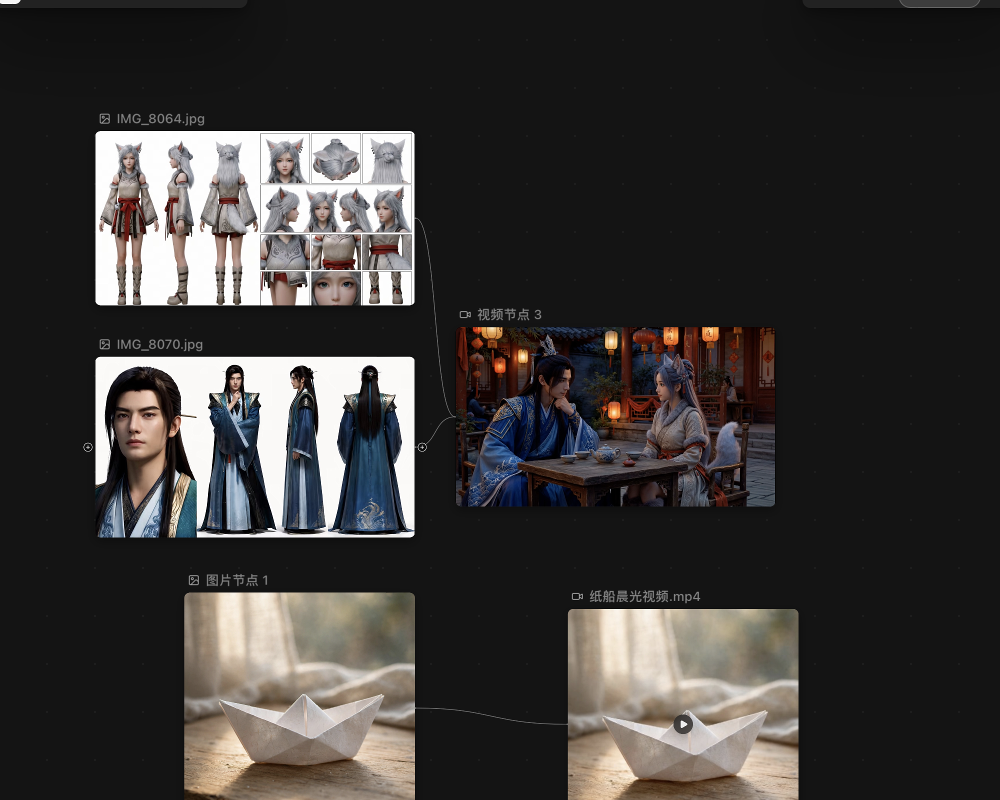
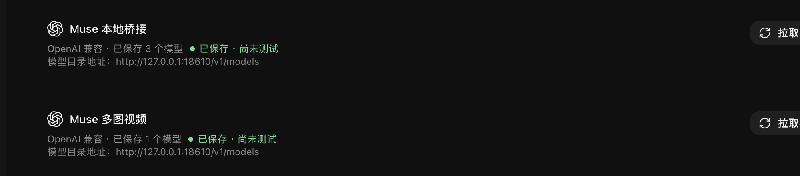

# Muse一键部署多图参考生成视频工作台

一个可由 Codex 调用的 Skill，指导从零搭建 BeefTV + muse2api 本地画布，配置 Muse 多角色参考视频、启动入口、验收和故障排查。Skill 提供经过本次实际运行检验的桥接兼容补丁；安装过程仍需要登录 Muse、导入会话并按提示配置渠道。



## 使用

将本仓库克隆到 Codex 技能目录（确保目标目录不存在）：

```bash
git clone https://github.com/zhenbai123/Muse-One-Click-Multi-Reference-Video-Workbench.git ~/.codex/skills/muse-beeftv-canvas
```

在 Codex 中输入：

> 使用 $muse-beeftv-canvas 帮我安装并配置 Muse 多图参考视频工作台。

Skill 会检查环境、从官方渠道准备 BeefTV 和 muse2api、应用匹配版本的本地兼容补丁，并指导账号导入、模型配置与测试。可用既有安装时应先备份、检查差异，不能强行覆盖。具体指令见 [SKILL.md](SKILL.md) 和 [安装说明](references/setup.md)。



## 已验证范围

2026 年 11 月 9 日，在 Intel Mac、macOS 14、BeefTV 2.1.6 和指定 muse2api 提交上，使用 JSON 视频协议向桥接发送两张角色图，任务完成并返回可播放视频。不同系统、版本、账号和素材可能有不同结果；此记录不能保证每次成功，成片时长、画幅、音频和参考一致性由上游决定。

muse2api 是非官方第三方桥接，依赖 Muse 网页和账号，生成可能消耗额度。不要将登录 Cookie、密钥、浏览器配置、私有日志或作品上传仓库。附带的 muse2api 补丁保留其上游 [MIT 许可](assets/muse2api-LICENSE.txt)。
